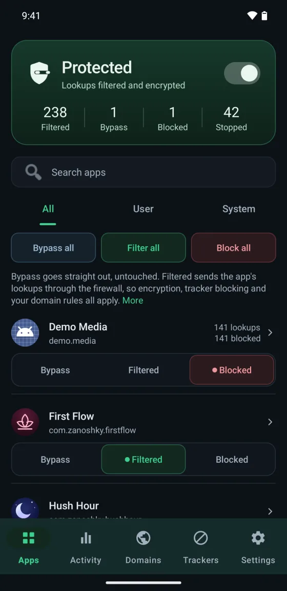

  

<h1 align="center">Firewall</h1>

A firewall for Android that needs no root, with tracker blocking, DNS over HTTPS, and a log of everything your phone looks up. Free, with an optional Pro.

  <a href="https://play.google.com/store/apps/details?id=com.zanoshky.firewall"><b>Google Play</b></a> ·
  <a href="https://firewall.zanoski.com"><b>firewall.zanoski.com</b></a> ·
  <a href="https://zanoshky.github.io/firewall-app/"><b>User guide</b></a> ·
  <a href="https://github.com/Zanoshky/firewall-app/issues/new/choose"><b>Report a bug</b></a>

  

This repo is the public home for Firewall users: the user guide, bug reports and feature requests. The app's source is not here.

## Quick start

1. Install Firewall from Google Play.
2. Turn it on with the switch at the top and allow the VPN when Android asks.
3. On the Apps tab, set each app to Bypass, Filtered or Blocked.
4. Open Activity to see what your phone looks up and what was stopped.

Read the full [user guide](https://zanoshky.github.io/firewall-app/guide.html) and the [questions and fixes](https://zanoshky.github.io/firewall-app/faq.html).

## Licence

The guide text and images are shared under [CC BY 4.0](LICENSE). The Firewall app itself is proprietary.
